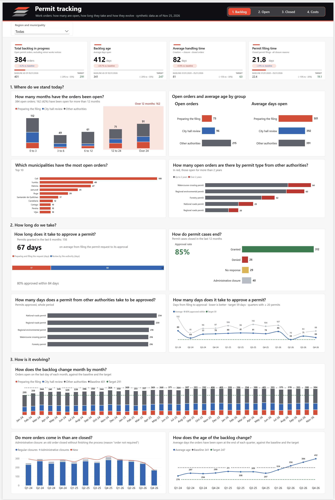
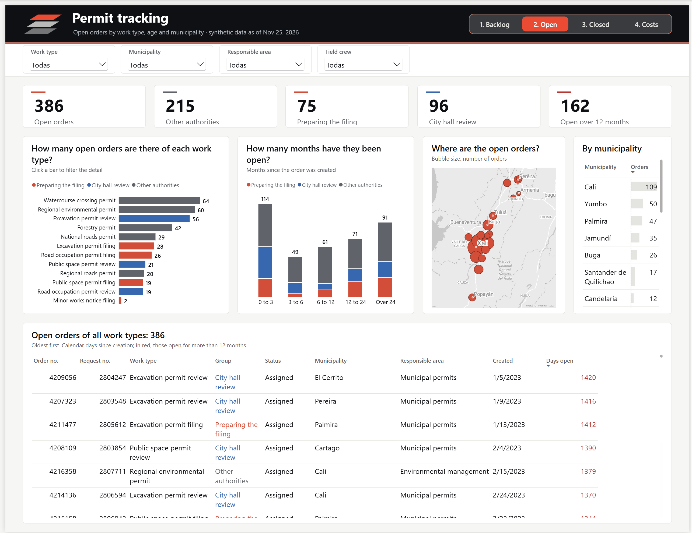
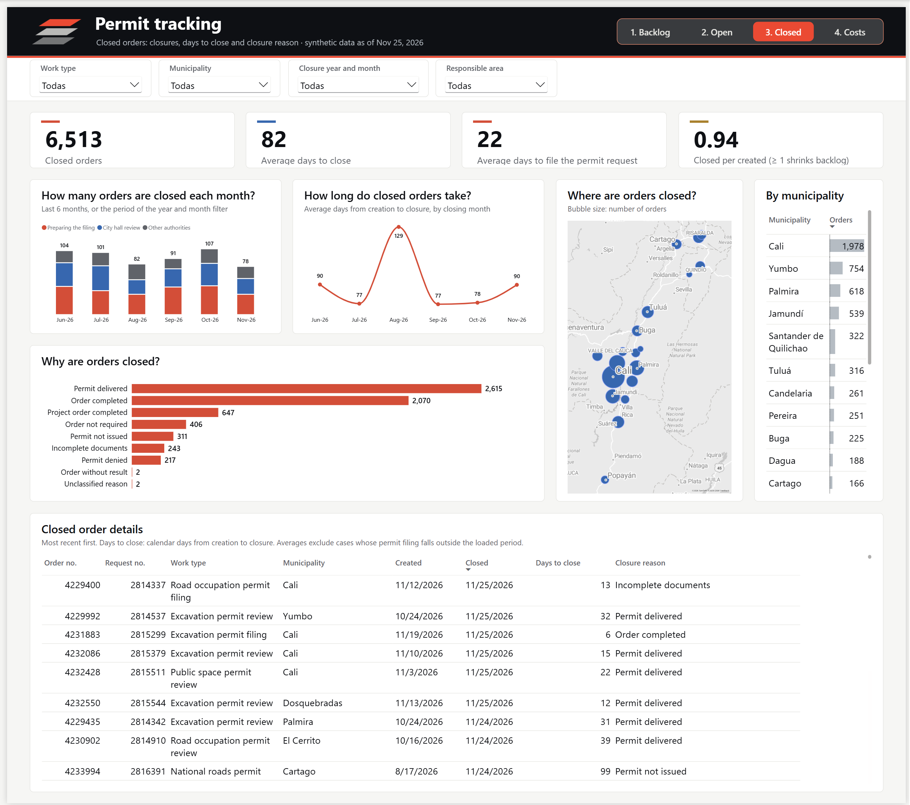
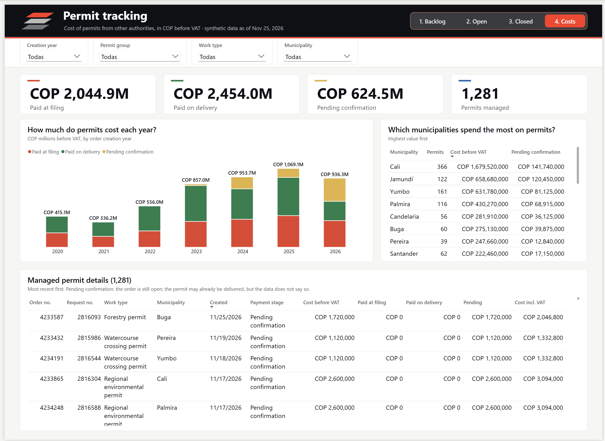
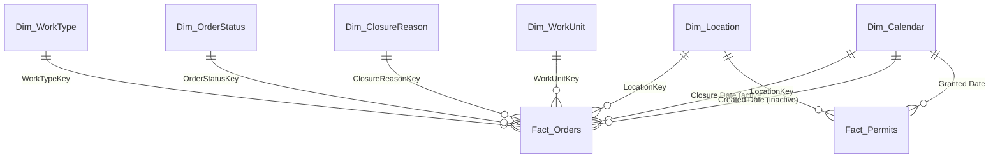

# Permit tracking · Power BI

      

A Power BI report about the backlog of work orders that wait for a permit: how many are open against a baseline and a target, how long permits take to be approved by the city hall and other authorities, and what they cost. It is a PBIP project: a star-schema semantic model in TMDL, Power Query, DAX and Deneb visuals, with the same report in Spanish and English.

> **All data is synthetic.** Companies, people and amounts are invented; only the municipality names are real.

## Pages

| Page | Question it answers |
|---|---|
| 1. Backlog | How big and how old is the backlog, how long do permits take and how has it changed since 2024? |
| 2. Open | Which work types, municipalities and teams hold the open orders, and since when? |
| 3. Closed | How many orders close, how long they take and why they close. |
| 4. Costs | How much do permits cost each year and in each municipality (COP, before VAT)? |






Spanish version: [1](docs/images/es/01-backlog.png) · [2](docs/images/es/02-abiertas.png) · [3](docs/images/es/03-cerradas.png) · [4](docs/images/es/04-costos.png)

## Open it

1. Install [Power BI Desktop](https://www.microsoft.com/power-bi/desktop).
2. Clone this repository and open `Permit-Tracking-EN.pbip` (English) or `Permit-Tracking-ES.pbip` (Spanish).
3. Select **Refresh**. The `DataRoot` parameter reads the files in `data/` from this repository on GitHub; point it to your local `data\` folder to work offline.

The map uses Azure Maps and the KPI cards use the Deneb custom visual, so Desktop may ask you to sign in or allow them.

## Data model

### Overview

The model is a star schema with two fact tables. `Fact_Orders` has one row per work order (it also carries the permit cost). `Fact_Permits` has one row per granted permit: the cycle of a request from filing created, to filing closed, to review closed with the permit granted. Both share the location and calendar dimensions; `Fact_Orders` also uses work type, status, closure reason and work unit.

All ages and deadlines are measured against the date in `data/snapshot.csv`, not against the system clock, so the report does not "expire" and the numbers stay the same on every refresh.

### Diagram



The creation-date relationship is inactive; measures that need it (for example orders created in a period) switch it on with `USERELATIONSHIP`.

### Tables

| Table | Type | What one row is | Source in `data/` |
|---|---|---|---|
| `Fact_Orders` | Fact | One work order, with its permit cost, payment stages and KPI window flags | `orders_history.parquet`, `orders_current.csv`, plus `config_work_types.csv`, `config_closure_reasons.csv`, `config_order_km.csv`, `config_rates.csv` |
| `Fact_Permits` | Fact | One granted permit (filing and review days of a request) | Same order files |
| `Dim_Calendar` | Dimension | One day, from January 1 of the oldest order year to December 31 of the year after the newest date or snapshot | Built in M from the order dates and `snapshot.csv` |
| `Dim_WorkType` | Dimension | One work type: group (Filing, Review, Standalone), responsible area, stage order, permit group | `config_work_types.csv` |
| `Dim_ClosureReason` | Dimension | One closure reason with its result (Granted, Denied, NoResponse, AdminClosure...) | Reasons in the orders; results from `config_closure_reasons.csv` |
| `Dim_OrderStatus` | Dimension | One status (Registered, Assigned, Closed; unknown codes become "Other") | Fixed catalog plus codes found in the orders |
| `Dim_Location` | Dimension | One location, matched to a municipality, department and coordinates | Location codes and names in the orders |
| `Dim_WorkUnit` | Dimension | One field crew | Work unit codes and names in the orders |
| `Rates` | Parameter | One permit rate by permit group and validity date: fixed value, per-km value, limits, VAT, share paid at filing | `config_rates.csv` |
| `Settings` | Parameter | A single row with baseline date, time window, age alert and start dates | `config_settings.csv` |
| `Targets` | Parameter | One backlog indicator with its expected reduction range and baseline cutoff | `config_targets.csv` |
| `Dim_AgeBand` | Helper (disconnected) | One age band (months since creation) for the age charts | Built in M |
| `KpiCards` | Helper (disconnected) | One KPI card of the Backlog page, with titles and units in both languages | Built in M |
| `Language` | Helper (disconnected, hidden) | One report language (`es`, `en`) | Built in M |
| `Info_Refresh` | Helper | One row with the snapshot date, read by `Today` | `snapshot.csv` |
| `_Measures` | Helper | Holds every measure; has no data | None |

What each configuration file drives:

- `config_rates.csv`: permit cost. Fixed value up to a number of km, a per-km value beyond it, a km limit, VAT (19 % by default) and the share paid at filing. The rate in force on the order creation date is used.
- `config_order_km.csv`: kilometres of each road permit order; with the rates, they set the cost of per-km permits.
- `config_settings.csv`: baseline date, time window in months for the granting time, age alert in months, and the start dates of the Backlog, Handling and Municipal indicators.
- `config_targets.csv`: expected reduction range of each indicator (Backlog, Age, Granting, Handling, Municipal) and its baseline cutoff. The target is the baseline reduced by the midpoint of the range.
- `config_work_types.csv`: groups, responsible area, whether the type counts in the backlog, and the permit group that sets its rate.
- `config_closure_reasons.csv`: labels in both languages and the result of each closure reason (granted, denied, no response, administrative closure...).

### Power Query

Queries are organised in groups: `1. Parameters`, `2. Functions`, `3. Staging`, `4. Dimensions`, `5. Facts` and `6. Support`.

- **Parameters.** `DataRoot` is the folder with the data: the raw GitHub address by default, or a local folder for offline work. `OrderFiles` lists the order files from oldest to newest: `orders_history.parquet;orders_current.csv`.
- **Reading files.** `fnReadFile` opens a file from the web or from disk depending on `DataRoot`. `fnReadCsv` reads a CSV with the first row as headers. Small helpers (`fnText`, `fnNumber`, `fnInteger`, `fnDate`, `fnDateTime`) clean cells and accept messy values such as `$ 4,500,000` or `19 %`.
- **History plus current.** `OrdersSource` reads each file (Parquet or CSV) and keeps its position in the list. `ExpectedColumns` matches headers by name, ignoring accents and case, and stops the refresh with a clear message if a required column is missing. `OrdersRead` stacks the files, adds empty columns that a file lacks and converts types. `OrdersUnique` keeps one row per order: if an order is in both files, the most advanced row wins (higher status, then latest dates) and, on a tie, the newest file. This is how the 2026 changes in the CSV replace the same orders in the history. Only work types of the catalog are kept.
- **Permits.** `OrdersPermits` keeps the permit work types. `RequestsOutsideData` flags requests whose first permit order is a review, because their filing is not in the data. `fnClosureResult` finds the result of a closure reason by code, and by normalised text if the code does not match.
- **Dimensions.** `fnMunicipality` finds the municipality in a location name using a catalog of towns with department and coordinates, plus a few aliases. `Dim_Calendar` builds the days with month and quarter labels in both languages.
- **Facts.** `Fact_Orders` links each order to its permit group, closure result and km, finds the rate in force on its creation date, computes cost, VAT and payment stages, and flags each KPI window from the start dates in `Settings`. `Fact_Permits` pairs each last granted review with its filing and computes filing, review and granting days.

### Measures

All measures live in `_Measures`, grouped in display folders: `Common`, `Orders\Configuration`, `Orders\Common`, `1. Backlog` (with `Backlog KPI`, `Age KPI`, `Granting KPI`, `Handling KPI`, `Municipal KPI` and `KPI Cards`), `2. Open Orders`, `3. Closed Orders` and `4. Costs`. Each indicator has the same set: current value, baseline, target, variation, progress and card texts.

| Measure | What it returns |
|---|---|
| `KPI Backlog` | Open orders of the backlog work types created since the backlog start date, at the end of the cutoff day |
| `Baseline Backlog` / `Target Backlog` | The same count at the baseline cutoff, and that baseline reduced by the midpoint of the target range |
| `KPI Age` | Average calendar days the backlog orders have been open |
| `Aged Backlog` | Backlog orders open for at least the alert age (12 months by default) |
| `KPI Handling` | Average days from creation to closure of closed backlog orders |
| `KPI Municipal` | Average days from creation to closure of closed filing orders |
| `P80 Granting` | Days within which 8 out of 10 permits granted in the time window were granted |
| `Grant Rate` | Granted reviews divided by granted, denied and no-response reviews, last 12 months |
| `Closed Per Created Order` | Closed orders divided by orders created in the period; above 1 the backlog goes down |
| `Open Orders` / `Closed Orders` | Orders in status Registered or Assigned, and orders closed in the period |
| `Permit Value` | Cost of the managed permits before VAT, by creation date |
| `Delivery Confirmed` / `Pending Confirmation` | Part of the cost paid after the permit is delivered, and part still waiting for confirmation on open orders |

### Bilingual design

A hidden `Language` table and the `Lang` measure hold the report language. Dimensions and facts have ES/EN column pairs (for example `Group ES` and `Group EN`), and text measures use `SWITCH` on `Lang` to choose labels, subtitles and date formats. Two reports, `Permit-Tracking-ES.Report` and `Permit-Tracking-EN.Report`, share the same semantic model; each one selects its language and sets its own `settings.locale` (`es-CO` and `en-US`).

### Project layout

```
Permit-Tracking.SemanticModel/   shared model (TMDL)
Permit-Tracking-ES.Report/       Spanish report (PBIR)
Permit-Tracking-EN.Report/       English report (PBIR)
data/                            synthetic CSV and Parquet files, snapshot date 2026-11-25
docs/images/                     screenshots
```

## Author

**Juan David Colonia Aldana** · Systems Engineer, data and software

- Portfolio: [jdcolonia.github.io/portfolio](https://jdcolonia.github.io/portfolio/en/)
- LinkedIn: [juan-david-colonia-aldana](https://www.linkedin.com/in/juan-david-colonia-aldana-733051209)
- GitHub: [@jdColonia](https://github.com/jdColonia)

Built as a portfolio project from a report I designed at work, rebuilt with synthetic data and no company assets.
